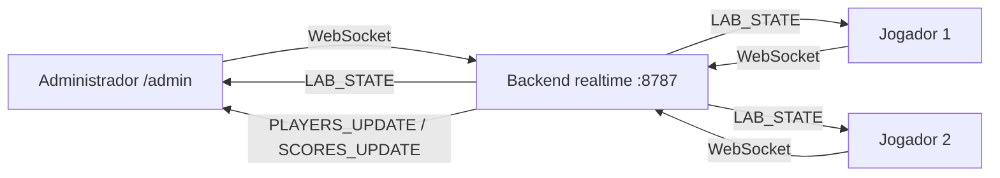

# INITIUM

## Documentação técnica

INITIUM é uma aplicação web de treinamento e simulação de resposta a incidentes cibernéticos. O sistema apresenta um console Linux simulado, organiza uma campanha em fases, controla pontuação e permite que um administrador libere o laboratório para todos os jogadores simultaneamente.

## 1. Arquitetura

O projeto é dividido em duas aplicações:

- **Frontend**: aplicação React/Vite responsável pela interface, jogo, lobby, painel administrativo e persistência local.
- **Backend**: relay WebSocket responsável por distribuir o estado do laboratório, presença dos jogadores e pontuações entre clientes conectados.



O backend não executa regras do jogo. Ele mantém o último estado conhecido e retransmite mensagens para os clientes conectados.

## 2. Estrutura de diretórios

```text
INITIUM/
├── Backend/
│   ├── package.json
│   ├── package-lock.json
│   └── realtime.mjs
├── Frontend/
│   ├── public/images/
│   ├── src/
│   │   ├── assets/
│   │   ├── components/
│   │   ├── game/
│   │   ├── utils/
│   │   ├── App.tsx
│   │   ├── index.css
│   │   ├── main.tsx
│   │   └── realtime.ts
│   ├── index.html
│   ├── package.json
│   ├── package-lock.json
│   ├── tsconfig.json
│   └── vite.config.ts
├── DOCUMENTACAO_TECNICA.md
└── package.json
```

O `package.json` da raiz funciona como orquestrador. As dependências de frontend e backend são instaladas separadamente.

## 3. Tecnologias

### Frontend

- React 19
- TypeScript 5.9
- Vite 7
- Tailwind CSS 4
- Framer Motion
- `vite-plugin-singlefile` para gerar um HTML de distribuição com os assets empacotados

### Backend

- Node.js
- ECMAScript Modules
- `ws` 8
- WebSocket puro, sem framework HTTP adicional

## 4. Execução local

Na raiz do projeto:

```bash
npm run install:all
```

Inicie o backend em um terminal:

```bash
npm run realtime
```

Inicie o frontend em outro terminal:

```bash
npm run dev
```

Comandos adicionais:

```bash
npm run build
npm run preview
```

O frontend usa a porta padrão do Vite. O backend usa a porta `8787`.

Variáveis opcionais do backend:

```text
REALTIME_PORT=8787
REALTIME_HOST=0.0.0.0
```

Variável opcional do frontend:

```text
VITE_REALTIME_URL=ws://servidor:8787
```

Quando `VITE_REALTIME_URL` não é definida, o frontend monta automaticamente a URL usando o host atual e a porta `8787`. Para `localhost`, ele usa `127.0.0.1` para evitar problemas de resolução IPv6.

## 5. Rotas da aplicação

### `/`

Fluxo principal do jogador:

1. Login ou criação da conta local.
2. Lobby de espera.
3. Liberação pelo administrador.
4. Briefing da missão.
5. Console de jogo.
6. Pausa, conclusão ou falha da campanha.

### `/admin`

Painel administrativo separado do fluxo do jogador. Ele permite:

- Autenticação administrativa.
- Visualização do estado do laboratório.
- Início do laboratório.
- Reset do laboratório.
- Visualização de jogadores online.
- Ranking de pontuação em tempo real.
- Consulta dos recordes históricos.

A senha administrativa atual é `admin`. Essa autenticação ainda ocorre no frontend e não deve ser considerada adequada para produção.

## 6. Modelo de estado do laboratório

O estado transmitido pelo WebSocket possui a seguinte estrutura lógica:

```ts
type LabState = {
  status: "aguardando" | "em_andamento" | "finalizado";
  startTime?: number;
  durationSeconds: number;
  adminOperator?: string;
};
```

### Estados

- `aguardando`: jogadores podem entrar, mas o console ainda não foi liberado.
- `em_andamento`: o laboratório foi iniciado e todos os clientes devem entrar na missão.
- `finalizado`: o prazo global terminou ou o administrador encerrou o ciclo.

Quando o backend recebe um `LAB_STATE` com status `em_andamento`, ele substitui `startTime` pelo próprio `Date.now()`. Assim, o horário oficial não depende do relógio do administrador.

## 7. Sincronização em tempo real

O cliente realtime está em [Frontend/src/realtime.ts](Frontend/src/realtime.ts). Ele oferece:

- Conexão WebSocket.
- Fila de mensagens enquanto a conexão ainda está abrindo.
- Reconexão automática com backoff de até 5 segundos.
- Fechamento limpo ao desmontar o componente.
- Fallback local através de `BroadcastChannel` e `localStorage`.

Mensagens suportadas:

```ts
type RealtimeMessage = {
  type: "LAB_STATE" | "PLAYERS_UPDATE" | "SCORES_UPDATE";
  payload: unknown;
};
```

### `LAB_STATE`

Usada pelo administrador para iniciar ou resetar o laboratório. O backend retransmite a mensagem para todos os clientes.

### `PLAYERS_UPDATE`

Contém a lista de jogadores e seus estados atuais:

```ts
type PlayerRecord = {
  id: string;
  nome: string;
  score: number;
  fase: number;
  ultimaAtualizacao: number;
  online: boolean;
};
```

O backend deduplica os jogadores pelo campo `nome`. O cliente faz `upsert`, preservando o `id` existente e substituindo score, fase e timestamp.

### `SCORES_UPDATE`

Contém o ranking histórico. O painel substitui sua cópia local pelo payload recebido.

## 8. Cronômetros

Todos os clientes calculam o tempo restante a partir de:

```text
tempo restante = startTime + durationSeconds - Date.now()
```

O arquivo [Frontend/src/game/clock.ts](Frontend/src/game/clock.ts) fornece:

- `getRemainingSeconds`: cálculo absoluto do tempo restante.
- `startPreciseClock`: ticker alinhado ao próximo segundo.

Características:

- Não há contagem acumulativa baseada em `setInterval`.
- Abas em segundo plano são corrigidas ao retornar para o primeiro plano.
- O console, lobby e painel usam o mesmo `startTime`.
- O backend é a autoridade do instante inicial.
- A interface exibe segundos, mas o cálculo interno usa milissegundos.

## 9. Organização do jogo

As missões estão em [Frontend/src/game/model.ts](Frontend/src/game/model.ts).

O conteúdo atual possui:

- 6 fases ativas na campanha de 90 minutos.
- 34 tasks no total.
- Orçamento global de 1 hora e 30 minutos.
- Média teórica de aproximadamente 159 segundos por task.

A estrutura de uma fase contém alvo, IP, processos, sockets, arquivos simulados e objetivos. Cada objetivo pode ter requisitos múltiplos e uma função de validação do estado do mundo.

O terminal simulado está em [Frontend/src/game/shell.ts](Frontend/src/game/shell.ts). Ele altera o `World` em memória e retorna linhas, penalidades e eventos para a interface.

## 10. Pontuação

A pontuação é calculada em [Frontend/src/game/scoring.ts](Frontend/src/game/scoring.ts).

Faixas de tempo por task:

| Faixa | Tempo máximo | Multiplicador |
|---|---:|---:|
| S | 12 s | 3.00x |
| A | 30 s | 2.20x |
| B | 60 s | 1.60x |
| C | 120 s | 1.15x |
| D | acima de 120 s | 0.75x |

A conclusão de um objetivo:

1. Calcula o tempo da task.
2. Aplica o multiplicador de faixa.
3. Aplica combo e penalidades.
4. Atualiza o score local.
5. Publica `PLAYERS_UPDATE` para o painel.
6. Salva o progresso local.

O score atual do jogador é definido, não incrementado, na atualização realtime. Isso torna o envio idempotente: repetir a mesma mensagem não duplica nem soma pontos.

## 11. Persistência

### `localStorage`

O frontend usa armazenamento local para dados de compatibilidade e fallback:

- `initium.auth.user`: sessão local do operador.
- `initium.auth.v1`: credenciais locais do jogador.
- `initium.lab.global`: último estado local do laboratório.
- `initium.lab.players`: cópia local dos jogadores.
- `initium.hiscores.v1`: recordes históricos.
- Chaves do progresso da campanha em [Frontend/src/game/save.ts](Frontend/src/game/save.ts).

### Memória do backend

O backend mantém em memória:

- `lab`
- `players`
- `scores`

Ao reiniciar o processo Node, esse estado é perdido. Para produção, deve ser adicionada uma persistência externa, como PostgreSQL, Redis ou outro banco compartilhado.

## 12. Presença online

O jogador é registrado como online ao entrar no fluxo autenticado/lobby. A transição do lobby para o console não o marca mais como offline. O logout explícito publica `online: false`.

Para uma presença de produção, recomenda-se complementar esse comportamento com:

- Heartbeat periódico.
- Timeout no backend para conexões sem atividade.
- Associação entre jogador autenticado e socket WebSocket.
- Evento de desconexão no servidor.

## 13. Segurança atual e pendências

A implementação atual é adequada para protótipo/local, mas requer endurecimento para produção:

1. A senha administrativa `admin` está no bundle do frontend.
2. O backend aceita mensagens WebSocket sem autenticação.
3. Qualquer cliente conectado pode publicar `LAB_STATE`, `PLAYERS_UPDATE` ou `SCORES_UPDATE`.
4. O estado realtime é perdido ao reiniciar o backend.
5. O WebSocket usa `ws://`; em produção deve ser usado `wss://` atrás de TLS.
6. O servidor precisa de autenticação, autorização por papel e validação de payload.
7. O relay deve limitar tamanho, frequência e origem das mensagens.
8. O acesso externo à porta `8787` deve ser protegido por firewall ou proxy reverso.

## 14. Operação em rede

Para permitir acesso de outros computadores na rede local:

1. Inicie o backend com `REALTIME_HOST=0.0.0.0`.
2. Libere a porta `8787` no firewall do servidor.
3. Inicie o Vite acessível pela rede.
4. Acesse o frontend usando o IP do computador servidor.
5. Confirme que o frontend consegue abrir `ws://IP_DO_SERVIDOR:8787`.

Em ambiente publicado, prefira um proxy reverso que encaminhe:

```text
https://app.exemplo.com       -> Frontend
wss://app.exemplo.com/realtime -> Backend :8787
```

## 15. Diagnóstico rápido

### Painel mostra score antigo

- Confirme que `npm run realtime` está ativo.
- Verifique se a porta `8787` está liberada.
- Recarregue o painel após atualizar o bundle.
- Confira se o navegador consegue abrir `ws://IP:8787`.

### Jogador aparece offline durante o console

- Confirme que o frontend está usando a versão atual.
- Verifique o `PLAYERS_UPDATE` no backend.
- Faça logout/login para renovar a presença.

### Cronômetros diferentes

- Confirme que todos receberam o mesmo `LAB_STATE`.
- Confirme que existe `startTime` no payload.
- Verifique se o relógio do sistema operacional está correto.
- Não use valores locais salvos como autoridade quando o WebSocket estiver disponível.

### Imagens não aparecem

As imagens públicas devem estar em `Frontend/public/images` e ser referenciadas como:

```css
url("/images/panel.jpg")
url("/images/crt.jpg")
```

## 16. Validação recomendada

Antes de publicar uma alteração:

```bash
npm run build
```

Para verificar o backend:

```bash
node --check Backend/realtime.mjs
```

Para testar o relay manualmente, conecte dois clientes WebSocket e confirme que uma mensagem `PLAYERS_UPDATE` ou `SCORES_UPDATE` publicada por um cliente chega ao outro.
